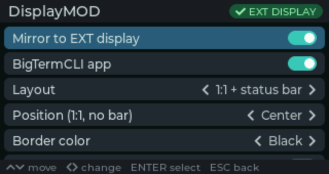
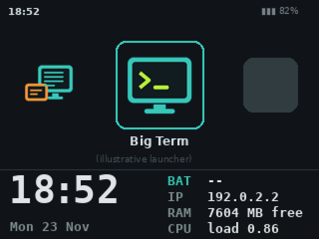
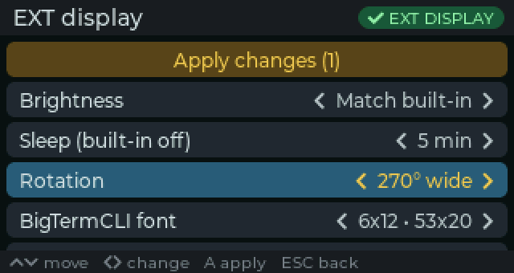

# DisplayMOD

Second screen for the M5Stack CardputerZero. DisplayMOD drives a 2.8" ILI9341 SPI display (the EXT display) from the EXT header and mirrors the built-in screen onto it. It also includes BigTermCLI, a full-size terminal that runs on the EXT display.

 

## Features

- 1:1 mirror of the built-in screen, with a status bar (clock, battery, IP, RAM, CPU) in the spare rows
- Layouts: status bar, stretch, or no bar with top/center/bottom position and a border color
- BigTermCLI: terminal on the EXT display with the same keys and colors as the CLI app
- Command history in BigTermCLI, saved after every command and kept across reboots
- Brightness follows the built-in screen, or set it yourself (10–100%)
- Option to keep the built-in screen off while mirroring, with an idle sleep timer
- EXT display detection at boot; if nothing is connected, the 5V output and driver stay off
- Settings in the DisplayMOD launcher app, or with the `displaymod` command over SSH

## Hardware

Tested with the common red "2.8 TFT SPI 240x320 V1.2" board (ILI9341, XPT2046 touch, SD slot). Leave the J1 jumper open so the board runs from 5V through its regulator.

| Display pin | EXT header pin | Signal |
|---|---|---|
| VCC | 6 | 5V out |
| GND | 4 | GND |
| CS | 13 | G7 (SPI0 CE1) |
| RESET | 5 | G22 |
| DC | 3 | G23 |
| SDI (MOSI) | 9 | G10 |
| SCK | 7 | G11 |
| LED | 1 | G26 |
| SDO (MISO) | 11 | G9 (detection) |

Leave the touch (T_*) and SD pins unconnected and don't use pin 2 (5V in). Power the CardputerZero off before wiring.

## Install

Copy the `.deb` to the CardputerZero, then:

```
sudo apt install ./displaymod_2.7.0_arm64.deb
sudo reboot
```

DisplayMOD and BigTermCLI appear in the launcher.

## Use

**DisplayMOD**: F/X move, Z/C change a value, Enter selects, Esc goes back.

Quick settings (brightness, border color, sleep, built-in screen, history) apply at once. Settings that restart the EXT display (mirroring, layout, position, rotation, font, SPI speed, color swap, detection) are queued and shown in amber; press **A** or choose **Apply changes** to apply them together. The `displaymod` command works the same way, with **p** to apply.



**BigTermCLI**: type on the CardputerZero, read on the EXT display.

| Keys | Action |
|---|---|
| fn+F / X | history up / down |
| fn+Z / C | cursor left / right |
| fn+K / N | line start / end |
| shift+fn+L / M | scroll back / forward |
| fn+1 … 0 | F1 … F10 |
| F6 (fn+6) | change text size |
| fn+H | help |
| hold Esc | quit |

`exit` ends the session; ctrl+B then D leaves it running for next time.

## Remove

From the app: Status & uninstall → Uninstall. Or:

```
sudo apt remove displaymod
```

## Build

Needs an arm64 cross compiler (`aarch64-linux-gnu-gcc`), `make`, `git` and `dpkg-deb`:

```
./build.sh
```

LVGL 9.2.2 is fetched into `src/ui/lvgl` on the first build.

## How it works

- `displaymod-ctl` (root) loads the kernel `fbtft` driver for the display, the `pwm-gpio` overlay for brightness, and starts the mirror. The apps reach it through a sudo rule that only allows this helper.
- `displaymod-mirror` copies changed rows from the built-in framebuffer to the EXT display and draws the status bar.
- `displaymod-term` (BigTermCLI) sends keys to a tmux session that the EXT display shows.
- `displaymod-ui` is the settings app (LVGL).

## License

MIT. See [LICENSE](LICENSE).
